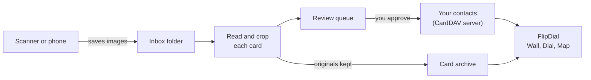

# FlipDial

**A self-hosted, visual contact manager for the business cards you collect.**
Scan, review, dial through, and sync to any CardDAV server.

> Status: early scaffold. Nothing here is usable yet. See [docs/build-plan.md](docs/build-plan.md).

## What it does

- **Keeps the card.** The original front and back scans are stored untouched, so the art on a card is never lost.
- **Reads it on your own hardware.** Name, title, company, email, phone and links are read from the card on a machine you control. Nothing leaves your network unless you turn that on.
- **You review before anything is saved.** Fields that may be wrong are flagged, and nothing is saved without your OK.
- **Syncs with standards.** Contacts are written as vCards to any CardDAV server (Synology Contacts, Nextcloud, Radicale, Baïkal and others).
- **Three ways to browse:**
  - **Wall:** every contact as a grid of cards
  - **Dial:** spin through your deck one card at a time
  - **Map:** where you met people
- **Mixes scanned and unscanned contacts.** Contacts without a scan get a generated "house card" so everything browses the same way.
- **Finds duplicates** and merges them field by field, with undo.

## How it fits together

1. Scan cards with any scanner or phone that can save to a folder.
2. FlipDial straightens each card, keeps the original images, and reads the contact details.
3. You check the details in the review queue.
4. Approved contacts are saved to your contacts server, and you browse them in FlipDial.

More detail in [docs/architecture.md](docs/architecture.md).

## Principles

- **Local first.** No cloud services, no tracking, no outside downloads.
- **Your data stays yours.** Standard vCard and CardDAV, plus full export of contacts and original scans.
- **Card text is untrusted input.** See [docs/threat-model.md](docs/threat-model.md).

## Documentation

| Doc | What it covers |
|---|---|
| [Build plan](docs/build-plan.md) | Phases, milestones, scope |
| [Architecture](docs/architecture.md) | Components and data flow |
| [Ingest](docs/ingest.md) | Scanner setup, pairing modes, what gets refused |
| [Reading cards](docs/extraction.md) | Fields, checks, flags, accuracy testing |
| [Contacts server](docs/carddav.md) | CardDAV setup, Synology, what is written and kept |
| [Data model](docs/data-model.md) | vCard fields and FlipDial extensions |
| [Threat model](docs/threat-model.md) | Assets, threats, mitigations |
| [Release checklist](docs/release-checklist.md) | What must pass before v1, including accuracy targets |
| [Contributing](CONTRIBUTING.md) | Setup and the no-private-data rule |
| [Security](SECURITY.md) | Reporting vulnerabilities |

## License

[MIT](LICENSE)
