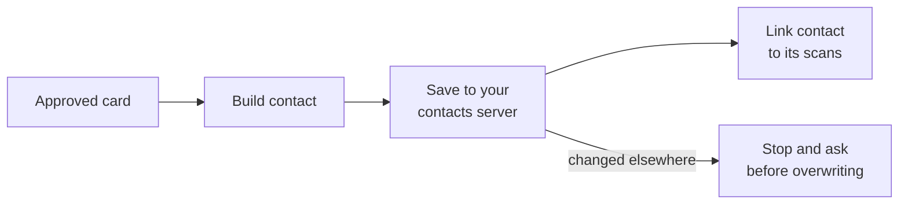

# Contacts server (CardDAV)

**No server yet?** FlipDial works without one: contacts are saved as vCard files in your data folder (`local-contacts`), and everything else works the same. When you add a server later, **Setup check** offers to copy them across in one step. Contacts already on the server are skipped, and the local folder is kept as a backup.

Approved cards are saved as contacts on your CardDAV server. FlipDial works with any CardDAV server; it is tested against Radicale in CI, and the v1 release checklist adds Synology Contacts and Nextcloud.



## Settings

```sh
FLIPDIAL_CARDDAV_URL=https://contacts.example.com/carddav/
FLIPDIAL_CARDDAV_USERNAME=
FLIPDIAL_CARDDAV_PASSWORD=          # use an app password where your server offers one
FLIPDIAL_CARDDAV_ADDRESSBOOK=       # optional: name or path; default is the first one found
FLIPDIAL_VCARD_VERSION=3.0          # 3.0 works with the widest range of apps; 4.0 also supported
FLIPDIAL_CARDDAV_VERIFY_TLS=true
FLIPDIAL_CARDDAV_CA_BUNDLE=         # optional: CA file for a server with its own certificate
```

Check the connection:

```sh
flipdial carddav check
```

It prints the address book name and how many contacts it holds. Nothing else.

The URL can be the server's address, your account's address, or one address book's address. FlipDial finds the address book from any of them.

### Synology Contacts

1. In Synology Contacts, hover over the address book, choose **⋮ > CardDAV**, and copy the URL.
2. Use that URL as `FLIPDIAL_CARDDAV_URL`, with a DSM account that can only use Contacts.
3. If the NAS uses its own certificate, export it and set `FLIPDIAL_CARDDAV_CA_BUNDLE`. Avoid turning off TLS checks.

## What FlipDial writes

| Property | Content |
|---|---|
| `FN`, `N` | Name |
| `ORG`, `TITLE` | Company and title |
| `EMAIL`, `TEL`, `URL`, `ADR` | Contact details |
| `SOCIALPROFILE` (4.0) or `X-SOCIALPROFILE` (3.0) | Social handles |
| `CATEGORIES` | Event deck, tags and `Starred`, merged with categories already there |
| `X-FLIPDIAL-*` | Event, date met, source, scan status, card ID; see [data model](data-model.md) |

## Phone, email, website and address types

Types are written the way Apple Contacts, Google Contacts, Android, Nextcloud and Outlook
read them, so they show up correctly in each app:

| In FlipDial | vCard 3 (vCard 4 uses lower case) |
|---|---|
| Phone: mobile, work, home | `TEL;TYPE=CELL,VOICE`, `WORK,VOICE`, `HOME,VOICE` |
| Phone: main, pager | `TEL;TYPE=MAIN` (`main-number` in vCard 4), `PAGER` |
| Phone: work fax, home fax, other fax | `TEL;TYPE=WORK,FAX`, `HOME,FAX`, `OTHER,FAX` |
| Email: work, personal | `EMAIL;TYPE=INTERNET,WORK`, `INTERNET,HOME` |
| Website: work, personal | `URL;TYPE=WORK`, `HOME` |
| Address: work, home | `ADR;TYPE=WORK:;;street;city;state;ZIP;country` |
| Homepage, blog, other, or your own label | Apple's label: `item1.URL:...` with `item1.X-ABLabel:_$!<HomePage>!$_` (or `BLOG`, `_$!<Other>!$_`, or the label text) |

When you edit a contact, every value you didn't change keeps the exact line the other app
wrote, including its preferred flag, Apple's iPhone type and the address country code.

## What FlipDial leaves alone

When FlipDial updates an existing contact, it only replaces the properties above. Everything else, such as birthdays, photos and fields other apps added, stays exactly as it was. Categories are merged, never replaced.

## Safety

- **No overwriting.** A new contact is only created if the address does not exist yet. Updates and deletes include the version FlipDial last read (ETag). If the contact changed on another device in the meantime, the server refuses and FlipDial stops instead of overwriting.
- **Stays in its lane.** Every address the server returns must be inside the chosen address book. Redirects are followed only to the same server.
- **Safe parsing.** Server responses are size-capped and parsed with protections against malicious XML.
- **Credentials stay secret.** The password is never logged or shown in errors.
