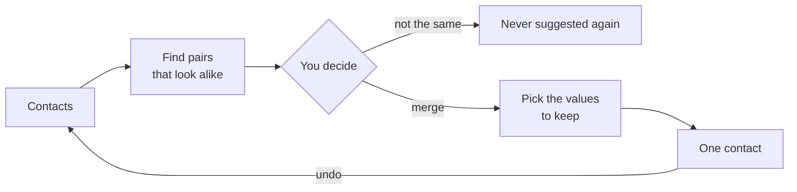

# Duplicates and merging

Mixing scanned cards, Google contacts and manual entries creates duplicates. FlipDial finds likely pairs, explains why they look alike, and lets you choose what to keep. Nothing is merged automatically, and every merge can be undone.

## How pairs are found

| Reason | Strength |
|---|---|
| Same email address | Strong |
| Same phone number (last 10 digits) | Likely |
| Same name and same company | Likely |
| Same name only | Possible |
| Very similar name | Possible |

Names are compared without accents, punctuation or word order. Company names ignore words like "Inc", "LLC" and "Studio".

## Merging

On the **Possible duplicates** page, choose **Merge** to see both contacts side by side:

- **Keep which record:** the contact that stays. FlipDial suggests the one with a scan.
- **Single values** (name, title, company, address, event): pick one side.
- **Lists** (emails, phones, websites): tick the values to keep. All are ticked by default.

The kept contact is updated on your contacts server and the other one is deleted there. If either contact was changed on another device since FlipDial last read it, the merge stops and nothing is deleted.

## Undo

Both contacts are saved exactly as they were before the merge. **Undo** puts both back, including links to their scans. Undo stops if the merged contact was edited afterwards, so later edits are never lost silently.

## New scans that match an existing contact

When a scan in the review queue looks like someone you already have, the review screen says so and offers **Add this scan to …**. The scan is linked to that contact: new values fill in or replace the old ones, and email addresses, phone numbers and websites are combined. **Save as a new contact** is still available.
