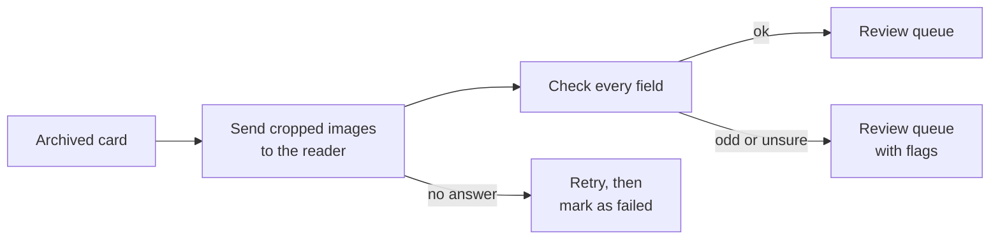

# Reading cards

After a card is archived, the extraction step reads its contact details and puts the card in the review queue. Nothing is saved to your contacts until you approve it.



## Run it

```sh
flipdial extract          # keep watching for new cards
flipdial extract --once   # read what is waiting and exit
flipdial worker           # ingest and extract together
```

## Where it runs

The reader is an Ollama server by default, or any OpenAI-compatible endpoint.

```sh
FLIPDIAL_MODEL_BACKEND=ollama            # or openai_compatible
FLIPDIAL_MODEL_URL=http://127.0.0.1:11434
FLIPDIAL_MODEL_NAME=qwen3.5:9b
```

Any vision model works: one whose `ollama show` lists **vision** under Capabilities. The default is `qwen3.5:9b`; `gemma4:12b` is another good candidate. Compare models on your own cards with `flipdial eval` and keep the one that scores best. Newer Ollama versions can no longer run `llama3.2-vision` (it fails with "unknown model architecture: 'mllama'"). The [Setup check](windows.md#when-cards-arent-being-read) shows Ollama's message when a model can't be loaded.

FlipDial refuses to start if the URL points outside your local network, because card images would leave it. Set `FLIPDIAL_ALLOW_REMOTE_MODEL=true` only if you mean to.

## Fields read from a card

Full name, given and family name, title, company, email addresses, phone numbers, websites, social handles and address. Each value comes with a confidence score.

## How the output is checked

Everything the reader returns is treated as untrusted:

- Only the fields above are kept. Anything else is dropped.
- Text is cleaned to a single plain line and capped at 200 characters.
- Emails, phone numbers, websites and handles must look right or they are removed. Links must be `http` or `https` and cannot carry a user name or password.
- The reader gets a fixed set of instructions, the card images and the field list. It cannot call tools, browse, or take any action.

Cards are flagged for a closer look when:

| Flag | Meaning |
|---|---|
| `low_confidence:<field>` | The reader was unsure about this value |
| `suspicious_text:<field>` | The text reads like instructions or code. It is shown as plain text and never acted on |
| `values_dropped` | Some values failed the checks and were removed |
| `no_name_or_company` | Neither a name nor a company was found |

## Retries

If the reader cannot be reached or returns something unusable, the card stays queued and is retried. After `FLIPDIAL_EXTRACT_MAX_ATTEMPTS` (default 3) it is marked as failed so it can be read again later or entered by hand.

## Measuring accuracy

Keep a set of your own scanned cards in a folder **outside this repository**. The easy way is to scan them, then let FlipDial build the folders:

```sh
# Scanner (duplex JPEGs, front then back). Your raw scans are left untouched.
flipdial testset make C:\flipdial-testset\raw C:\flipdial-testset\cards
# Phone photos go into the same test set; numbering continues
flipdial testset make C:\flipdial-testset\phone C:\flipdial-testset\cards --mode single
```

This runs the real ingest steps (pairing, blank-back detection, cropping) on a copy of the scans, so the test uses exactly the images the reader sees in normal use. Each card gets a folder with a blank `expected.json`. Fill each one in by hand from the physical card, not from what FlipDial reads, then check your progress:

```sh
flipdial testset check C:\flipdial-testset\cards
```

`make` refuses to write inside a git repository, so a test set can't end up committed by accident.

The layout, if you build one by hand:

```
my-testset/
  card-01/front.jpg
  card-01/back.jpg          (optional)
  card-01/expected.json     {"full_name": "...", "organization": "...",
                             "emails": ["..."], "phones": ["..."], "websites": ["..."]}
```

```sh
flipdial eval --testset /path/to/my-testset
```

Aim for the mix in the [release checklist](release-checklist.md): at least 30 cards, including artistic cards, cards with backs, tall or square cards, and a few phone photos.

The report lists, per field, how many values were expected, how many were right, and how many extra values appeared that are not on the card. It never prints names, values or folder names, so it is safe to share.
