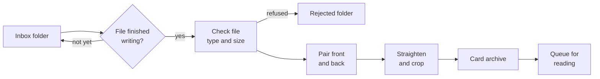

# Ingest: from scanner to archive

The ingest worker watches an inbox folder. When new scans settle, it pairs fronts and backs, straightens each card, archives the original files untouched, and queues the card for reading and review.



## Run it

```sh
flipdial ingest          # keep watching
flipdial ingest --once   # process what is there and exit
```

## Pairing modes

Set `FLIPDIAL_INGEST_MODE`.

| Mode | Use it when | How cards are formed |
|---|---|---|
| `auto` (default) | You are not sure | PDFs with an even page count are front/back pairs. Files named `...-front` and `...-back` are paired. Everything else is front only. |
| `duplex` | A sheet-fed duplex scanner saves one image per side | Files are paired in name order: 1+2, 3+4. PDFs are paired page by page. |
| `named` | You photograph cards with a phone | `jane-front.jpg` pairs with `jane-back.jpg`. Files without a side are front only. |
| `single` | You only scan fronts | Every image or PDF page is its own card. |

If a front is waiting for its back, the worker waits `FLIPDIAL_PAIR_TIMEOUT_SECONDS` (default 120) and then files it as front only.

## Scanner settings

- **Turn off blank page removal.** Duplex pairing depends on page order. FlipDial detects blank backs itself and hides them, while still keeping the original.
- **Duplex on**, if your scanner supports it.
- **300 dpi**, color.
- **Save as JPEG or PDF** into the inbox folder. A single PDF holding a whole stack works.
- Auto-crop and deskew in the scanner are fine to leave on.

### Fujitsu ScanSnap (for example the S1500 with ScanSnap Manager)

Make a separate scan profile for FlipDial (Scan Button Settings; labels vary a little by version):

| Setting | Value |
|---|---|
| Image quality | Superfine (300 dpi) |
| Color mode | Color |
| Scanning side | Duplex |
| Allow automatic blank page removal | Off (Option button) |
| Correct skewed text / rotate automatically | On |
| Reduce bleed-through | Off: it can wash out light text |
| Paper size | Automatic detection |
| File format | JPEG, compression at the lowest or second-lowest setting |
| Save to | FlipDial's inbox folder (or a private test-set folder) |
| Multifeed detection | On; turn off only if thick or textured cards trigger false alarms |

Load cards face down, top edge first, 10 to 15 at a time with the side guides snug. Feed very thick or oddly shaped cards one at a time. Set `FLIPDIAL_INGEST_MODE=duplex`.

## What gets refused

Files are checked by content, not by name. Refused files move to the `rejected` folder with a `reason.json`:

| Code | Meaning |
|---|---|
| `unreadable` | Not an image or PDF |
| `unsupported_format` | An image type FlipDial does not accept |
| `too_large` | Over `FLIPDIAL_MAX_FILE_MB` |
| `too_many_pixels` | Over `FLIPDIAL_MAX_PIXELS` |
| `too_many_pages` | PDF over `FLIPDIAL_MAX_PDF_PAGES` |
| `corrupt` / `empty` / `read_error` | Damaged, empty or unreadable file |

Accepted formats: JPEG, PNG, TIFF, WebP and PDF. Phone HEIC photos need the optional extra: `pip install "flipdial[heif]"`.

## Privacy notes

- Originals are copied byte for byte and verified by SHA-256 before the inbox copy is removed.
- Cropped copies and thumbnails carry no photo metadata, so a phone's GPS location is not copied.
- Card IDs are random and say nothing about the card. Logs show only card IDs, counts and reason codes, never file names or card text.
