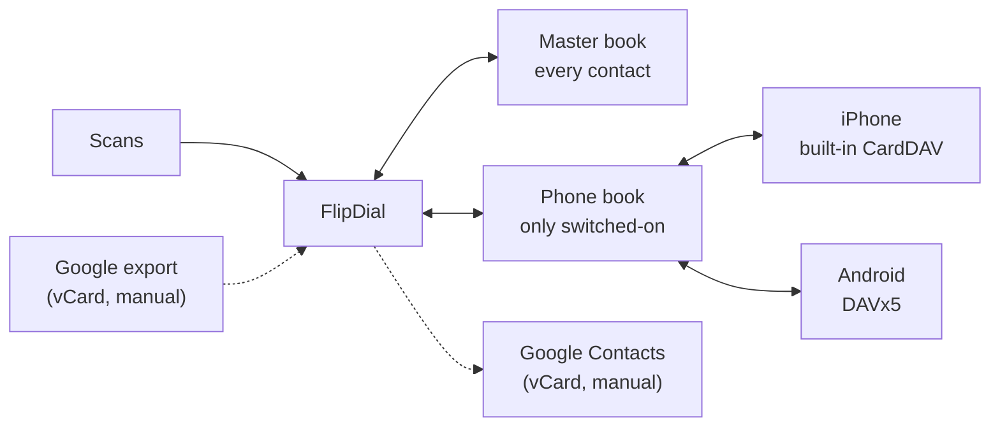

# Phone sync

Status: built (all five steps of the build order). The open checks at the end still need a real iPhone, Android phone and Synology. This page is the spec the code and tests are written against.

To turn it on, use **Setup > Phone > Set up phone sync** (below), or make a second address book on your contacts server (for example "Phone") and set:

```sh
FLIPDIAL_PHONE_ADDRESSBOOK=Phone
FLIPDIAL_PHONE_CHECK_HOUR=3        # the daily check, server time
```

FlipDial never picks the phone book as its main address book. Then choose what goes to the phone in **Setup > Phone**, or in a contact's card.

FlipDial keeps every contact and card. Your phone only gets the contacts you choose, so its address book stays short. Nothing is connected to your Google or Apple account, and nothing is reachable from the internet: the phone syncs when it is on your home network.



## Address books

Both live on the same CardDAV server: Synology Contacts, Radicale (optional, bundled with FlipDial's Docker setup), Nextcloud or any other.

| Address book | Holds | Who can use it |
|---|---|---|
| Master | Every contact, with FlipDial's own fields | FlipDial only |
| Phone | Copies of switched-on contacts, standard fields only | FlipDial and the phone |

The phone signs in with its own account, which can see the phone book and nothing else. If a phone is lost, change that one password.

## Choosing what goes to the phone

Off by default. Three levels, the most specific wins:

1. **Contact:** On, Off, or "Follow tags" (the default).
2. **Tag or deck:** On or Off. A contact with any tag that's On goes to the phone, unless the contact itself is set Off.
3. **Everything:** one switch for all contacts, Off by default.

Starred can be switched on like a tag. The reading pane shows whether a contact is on the phone and why ("On the phone, from Art Fair 2026"). Changing a rule shows the new count straight away. The first sync, and any sync that would remove more than 10 contacts, lists the changes and waits for you to confirm.

## What sync does

FlipDial updates the phone book as soon as you change a contact, and checks it for edits made on the phone once a day (the time is a setting) and when you press **Sync now**. The phone syncs on its own schedule whenever it is on your home network; away from home it simply keeps the contacts it has.

| Change | What happens |
|---|---|
| Contact switched on | A copy is added to the phone book |
| Contact edited in FlipDial | The phone copy is updated |
| Contact switched off | The phone copy is removed. The contact stays in FlipDial |
| Edited on the phone | The changed fields are copied to the master contact and shown in Activity |
| Edited in both places since the last sync | Fields changed on only one side are combined. A field changed on both sides is not overwritten: the contact appears in Review with both versions to choose from |
| Deleted on the phone | The contact is switched Off for the phone. The master contact is not touched |
| Added on the phone | It goes to Review as "Added on your phone". It is saved to the master book only if you approve it |

Phone copies carry the standard fields: name and its parts, company, department, title, phones, emails, websites, addresses, socials, nickname, birthday and notes. FlipDial's own fields (deck, star, scans, About) stay in the master book, and the phone cannot change them.

## Safety rules

Each rule has a test.

1. **The master book is never deleted from because of the phone book.** Deleting on the phone only switches the contact off for the phone.
2. **FlipDial removes only what it added.** Every phone copy is recorded with its UID and version. Other contacts in the phone book are never changed or removed.
3. **A sudden drop stops sync.** If the master or phone book has far fewer contacts than last time (more than 10, and more than a fifth), or can't be read, sync stops and shows a warning. An empty or unreachable address book never turns into deletions.
4. **Large changes need you.** The first sync, and any sync that would remove more than 10 contacts, waits for you to confirm the list.
5. **Never overwrite blind.** Every write sends the version FlipDial last saw. If the server copy changed since, the write is refused and the contact is checked again.
6. **Phone edits are untrusted input.** They are parsed, length-limited and checked for control characters field by field; a field that fails is ignored (and logged), never fixed. Fields the phone can't change are ignored. More than 10 contacts edited on the phone at once wait for you to confirm, in case a phone app rewrote them all.
7. **Phone edits can be undone.** Before a master contact is changed by an edit from the phone, the previous vCard is kept for 30 days, and the change can be undone from Activity. A copy is only removed from the phone book when it has no phone edits, so removing it loses nothing; switching the contact back on puts it back.
8. **Backups before bulk changes.** A backup of the master book is taken before the first sync and before any change to more than 10 contacts.
9. **Everything is logged.** Each change made by sync is in Activity, with where it came from. Logs never contain contact details or passwords.

## Setup wizard

**Setup > Phone > Set up phone sync** walks through three steps:

1. **Phone address book.** Pick an address book on the contacts server, or let FlipDial make one (named "Phone" unless you choose another name). The main address book can't be picked. If the server doesn't let FlipDial make one (Synology may not), the wizard says how to make it there.
2. **The phone's account.** The wizard explains how to give the phone its own account that can open only the phone book (on Synology: a DSM user, and the phone book shared with it). **Check the account** signs in as the phone would and shows whether it can open the phone book and whether it can also see the main address book, which it shouldn't. The password is used for that check only and never kept. The wizard warns if the phone would use FlipDial's own account.
3. **Add it to the phone.**
   - iPhone: **Make the iPhone link** shows a QR code. Scanning it downloads a profile that adds the CardDAV account in one step; the iPhone asks for the password, so the password is never in the file. If the contacts server has its own certificate (FLIPDIAL_CARDDAV_CA_BUNDLE), the profile carries it too. The link works once, expires after 15 minutes, and only a hash of it is stored.
   - Android: install DAVx5, choose "Login with URL and user name", and copy the address and user name the wizard shows.

The wizard warns when the phone couldn't reach the address: FlipDial opened as localhost, or the contacts server set as localhost. It also warns when the server uses http, since the phone would send its password unencrypted.

Choices made in the wizard are kept in FlipDial's database. FLIPDIAL_PHONE_ADDRESSBOOK in the settings file, if set, wins over them.

### Home network only

By design, the contacts server is reachable only on your home network. Nothing is opened to the internet, and the wizard never suggests port forwarding.

- The phone needs HTTPS it trusts on the home network. A home server usually has its own certificate, so the wizard offers it to the phone: inside the iPhone profile, and as a certificate DAVx5 asks you to accept once on Android.
- DAVx5 can be limited to your home Wi-Fi, so it doesn't try to sync elsewhere.
- Away from home, contacts already on the phone keep working. Changes wait until you are back.

Syncing away from home (for example through Tailscale) may come in a later release as an option you turn on.

## Bundled Radicale

For people with no contacts server: see [Bundled contacts server](contacts-server.md). In short, `flipdial contacts-server init` sets up Radicale with HTTPS (a certificate made for this server only), bcrypt passwords, and access rules where each phone account opens only its own phone book. The wizard then makes the phone's account and its book in one step. With Docker it is an optional service built from PyPI at pinned, hash-checked versions; with the Windows scripts it starts and stops with FlipDial. Set FLIPDIAL_PHONE_SERVER_URL to the address phones use when FlipDial reaches the server by another name.

## Google

No sign-in to Google, by design.

- **Into FlipDial:** export from contacts.google.com as vCard, then Import. A contact already in FlipDial (same UID, email or phone) is updated: new phones, emails, websites, addresses and socials are added, and empty fields are filled in. Nothing is removed. When both have a different value, FlipDial's is kept unless you tick "use the file's". The preview shows what each update adds, and the import can be undone (updated contacts go back to how they were, unless edited since). New contacts are added; a contact that matches only by name is skipped unless you ask for a copy.
- **Out to Google:** **Import / export > Changes for Google Contacts** downloads a vCard of contacts changed since the last download, with standard fields only (optionally only the contacts on your phone). Import it at contacts.google.com. Google may add copies instead of updating; its **Merge & fix** tool combines them.

## Build order

1. Phone book with the on/off rules, sync to it, and safety rules 1 to 5, 8 and 9.
2. Edits and additions from the phone, with rules 6 and 7.
3. Setup wizard, including the iPhone profile.
4. Import that updates matching contacts, and Export changes.
5. Bundled Radicale.

## To check before building

- Whether Synology Contacts lets FlipDial create an address book over CardDAV, and whether it can share one address book with another DSM user while keeping the master private.
- How quickly Radicale picks up a new account from its users file.
- The exact DAVx5 login steps on a current version, and whether it accepts a link or QR code.
- That an iPhone installs the profile and finds the phone book from its address (tested so far only by reading the profile back, not on an iPhone).
- How the iPhone handles a home server's own certificate: whether the profile alone is enough, or the user also has to turn on full trust in Settings (General > About > Certificate Trust Settings). The wizard's iPhone steps depend on this.
